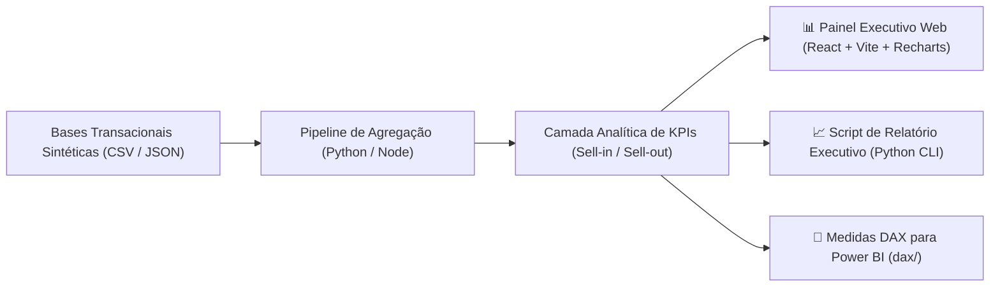

<div align="center">

# 🤝 Joint Business Planning (JBP) - Data Application & Análise de Metas Comerciais

[](https://manuarend.github.io/Portfolio/)
[](https://manuarend.github.io/Portfolio/)
[](https://react.dev)
[](https://tailwindcss.com)

**Painel Executivo Interativo para Gestão de Metas Comerciais B2B e Parcerias Industriais**

</div>

---

## 🌐 Demonstração Interativa Online (Live Demo)
> [!TIP]
> Você pode acessar o painel executivo funcionando ao vivo em qualquer navegador (sem necessidade de instalar nada):  
> 👉 **[Clique aqui para abrir o Painel Interativo no GitHub Pages](https://manuarend.github.io/Portfolio/)**  
> 
> *Funcionalidades ativas no painel:*
> - **Seleção dinâmica de fornecedores industriais** (*Eurofarma, EMS, Aché, Sanofi, Bayer, etc.*);
> - **Análise comparativa de canais** (*Loja Física, App, Site, Marketplace, Televendas*);
> - **Filtro regional de praças** (*Espírito Santo, Rio de Janeiro e São Paulo*);
> - **Alternância instantânea de tema** (*Modo Claro / Modo Escuro*);
> - **Visualizações interativas** (*Recharts, cartões de KPIs dinâmicos, rankings e análise de linhas de produtos*).

---

## 🔒 Diretrizes de Anonimização, LGPD e Sigilo Corporativo
> [!NOTE]
> - **Valores e Volumes 100% Descorrelacionados:** Todos os faturamentos e volumes foram sintetizados de forma aleatória e independente. Volumes estão estritamente contidos entre **1 e 50 unidades/lotes** e valores de faturamento entre **R$ 1.000,00 e R$ 10.000,00**.
> - **Sem Proporção com Dados Reais:** Não há multiplicação, fator redutor ou relação matemática com os números reais da empresa, inviabilizando qualquer engenharia reversa.
> - **Geolocalização:** Dados concentrados nas praças do Sudeste: **Espírito Santo (ES)** (*Vitória, Serra, Vila Velha, Linhares*), **Rio de Janeiro (RJ)** (*Rio de Janeiro, Niterói, Macaé, Volta Redonda*) e **São Paulo (SP)** (*São Paulo, Campinas, Santos, São José dos Campos*).
> - **Entidades e Marcas:** Nomes de indústrias são ilustrativos de mercado e a marca do distribuidor foi ficticiada como *Nexus Distribuição & Varejo B2B*.

---

## 🏗️ Arquitetura da Solução



---

## 🎯 Desafio de Negócio
Em grandes redes varejistas e distribuidoras, os planos de JBP envolvem dezenas de indústrias e milhares de SKUs. Os principais pontos críticos monitorados pelo painel são:
1. **Participação Digital (Digital Share %):** Crescimento do canal digital (*App, Site, Marketplace*) em relação às lojas físicas e televendas.
2. **Aderência às Metas Contratuais:** Acompanhamento dinâmico do faturamento realizado versus o compromisso do JBP.
3. **Desempenho por Linha e Indústria:** Identificação dos fabricantes que sustentam o crescimento ou que demandam intervenção promocional.
4. **Mix Geográfico:** Desempenho e penetração nos polos estratégicos de ES, RJ e SP.

---

## 📊 Arquitetura de Dados

### 1. Aplicação Web Interativa (`app/src/data/jbp_aggregated_data.json`)
Dataset sintetizado com estrutura hierárquica por indústria, mês, categoria mercadológica, canais e UFs.

### 2. Base Tabular para Análise Direta ([`data/jbp_acordos_sintetico.csv`](data/jbp_acordos_sintetico.csv))
| Campo | Tipo | Descrição | Exemplo |
| :--- | :--- | :--- | :--- |
| `id_acordo` | String | Código único do acordo | `JBP-0001` |
| `mes_referencia` | String | Competência avaliada | `2026-03` |
| `industria_parceira` | String | Fabricante parceiro | `Eurofarma`, `EMS`, `Aché`, `Sanofi` |
| `cidade_polo` / `uf_operacao` | String | Localidade (`ES`, `RJ`, `SP`) | `Vitória` / `ES` |
| `faturamento_realizado` | Decimal | Vendas faturadas (R$ 1.000 a R$ 10.000) | `R$ 6.820,00` |
| `meta_faturamento` | Decimal | Meta estipulada no plano | `R$ 6.500,00` |
| `atingimento_pct` | Decimal | % de alcance da meta | `104.9%` |
| `verba_cooperada` | Decimal | Investimento conjunto em marketing | `R$ 1.500,00` |
| `sla_entrega_pct` | Decimal | Pontualidade de entrega | `96.4%` |

---

## 📈 Indicadores Principais (KPIs)
- **Atingimento Financeiro:** `(Faturamento Realizado / Meta) * 100`.
- **Digital Share (%):** `(Faturamento Canais Digitais / Faturamento Total) * 100`.
- **Alavancagem de Verba (ROI JBP):** `Faturamento Realizado / Verba Cooperada`.
- **Crescimento YoY (Year-over-Year):** `(Receita Mês Ano Atual / Receita Mês Ano Anterior - 1) * 100`.

---

## 💻 Como Executar Localmente

### 1. Rodar o Dashboard Interativo (React + Vite)
```bash
cd 01-jbp-joint-business-planning/app
npm install
npm run dev
```
O painel abrirá automaticamente em `http://localhost:5173`.

### 2. Rodar a Rotina de Análise Executiva (Python)
```bash
cd 01-jbp-joint-business-planning/scripts
python analise_jbp.py
```

### 3. Fórmulas DAX para Power BI
As fórmulas completas de medidas para dashboards no Power BI estão documentadas em [`dax/medidas_jbp.dax`](dax/medidas_jbp.dax).
